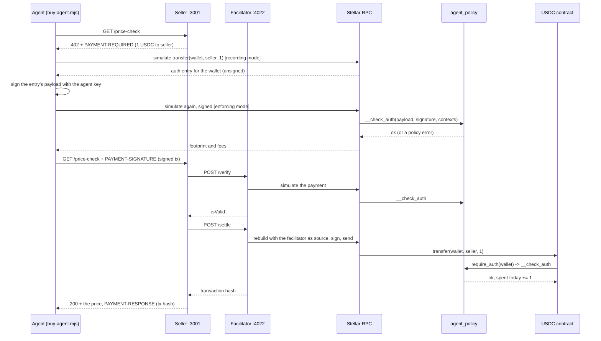
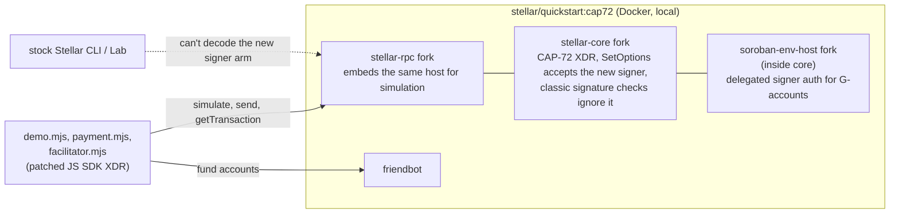

# How the CAP-72 demo fits together

This page explains every moving part of the demo, how they talk to each other,
and what changes between version B (testnet, works today) and version A (a local
network running CAP-72). For running it, see [README.md](README.md). For the
reasoning behind the design, see [CAP72-demo-spec.md](CAP72-demo-spec.md).

## The idea in one paragraph

An AI agent needs a wallet its owner can trust. The owner wants rules (at most
$1 per payment, $2 a day, only these sellers) that hold even if the agent's
software is buggy or gets prompt-injected. So the rules live onchain, in a
contract called `agent_policy`. The agent holds a key, but that key isn't a
signer on any account. The only thing it can do is satisfy `agent_policy`'s
`__check_auth`, and that function says yes only to payments that follow the
rules. Today that wallet has to be a smart account (a C-address), and nobody can
fund one with a normal payment. CAP-72 would let a plain G-account (funded like
any exchange account) add `agent_policy` as a "delegated signer", so the same
rules guard a normal account.

## The pieces

| Piece | File | Role |
| --- | --- | --- |
| Wallet contract (B+) | `contracts/agent_wallet/src/lib.rs` | Smart account standing in for a CAP-72a G-account: holds the USDC, lists delegated signers with weights (owner-managed, like `SetOptionsOp`), and forwards every authorization to them with CAP-71-01's `delegate_auth`. Refuses delegated auth for calls on itself, and non-contract signers |
| Policy contract | `contracts/agent_policy/src/lib.rs` | Soroban custom account. Holds the rules, checks the agent's signature, checks every payment, tracks the day's spending. Owner-only `update_rules` and `withdraw` |
| Seller (x3) | `../server.js` | True Prices, an x402 API: `GET /price-check?item=…` for $1. The demo runs it three times (below) |
| Facilitator | `facilitator.mjs` | Verifies and settles x402 payments. Stock `ExactStellarScheme` from `@x402/stellar` with stock settings, plus a `GET /log` of verify results |
| Agent signer | `signer.mjs` | Signs Soroban auth entries for `agent_policy` with the agent's ed25519 key, as an `AgentSignature { public_key, signature }`. Exposes `authorizeEntry`, so the stock x402 client can use it |
| x402 for SDK 17 | `../vendor/x402-stellar` | Our port of `@x402/stellar` 2.28 to `@stellar/stellar-sdk` 17, plus delegated credentials and custom-account signers ([PORT.md](../vendor/x402-stellar/PORT.md)) |
| Payment builder | `payment.mjs` | Builds the payment by hand, simulated twice (see below). Its `PolicyExactScheme` is the misbehaving agent's x402 scheme: it sends the payment even when the policy refuses it |
| Agent (buyer) | `buy-agent.mjs` | Makes one purchase: request, get 402, build and sign the payment, retry with it. Stock x402 client when well-behaved, `PolicyExactScheme` when not |
| Direct submit | `direct-submit.mjs` | Sends a policy-breaking payment straight to RPC, around the facilitator, so there's a failed transaction onchain |
| Read helpers | `chain.mjs` | Simulated reads: balances, rules, today's spending |
| Runner | `demo.mjs` | Starts the facilitator and sellers, runs the four steps, handles the live edits |
| Setup | `setup-b.sh` | Testnet identities, USDC, deploys the contract, writes `.env` |

The three seller instances:

| Port | Price | payTo | Shows |
| --- | --- | --- | --- |
| 3001 | $1.00 | the allowed seller | a payment that follows the rules |
| 3002 | $1.00 | a second seller, not allowlisted | `SellerNotAllowed` |
| 3003 | $2.00 | the allowed seller | `PaymentTooLarge` (the amount is the only problem) |

## Who holds which key

| Key | Held by | Can do |
| --- | --- | --- |
| Owner (`cap72-owner`) | The person who owns the wallet, in the Stellar CLI keystore | Deploys the policy, changes the rules, withdraws |
| Agent (`cap72-agent`) | Only the agent (`.env`) | Nothing by itself. Not a signer on any account; it only satisfies `agent_policy`'s `__check_auth` |
| Funder (`cap72-funder`) | Plays the exchange or ramp | Sends the wallet its USDC; also pays the fee for the direct submission |
| Facilitator (`cap72-facilitator`) | The facilitator | Pays network fees and submits settled payments. Never the payer |
| Sellers (`cap72-seller`, `cap72-seller2`) | The sellers | Receive USDC |

## One paid request, end to end

So `__check_auth` runs three times for one purchase: in the agent's own
simulation, in the facilitator's verify simulation, and for real when the
transaction applies. Only the last one changes state.

### Why the payment is simulated twice

The first simulation runs in recording mode. It finds out which addresses need
to authorize the call and returns their unsigned auth entries, but it never runs
`__check_auth`, because nothing is signed yet. So its footprint leaves out the
policy contract's code, its instance (the rules) and today's spending entry. The
agent signs the entry and simulates again in enforcing mode. That run calls
`__check_auth`, so its footprint is complete, and it also tells the agent
whether the policy will accept the payment.

### Why the agent signs with a custom signature

A normal account signature is a vector of `{public_key, signature}` maps, and
the SDK builds it for you. A custom account decides its own signature type.
`agent_policy` takes one `AgentSignature { public_key, signature }`, so the
signer passes a ready-made `signatureScVal` to the SDK's `authorizeEntry`.
Upstream `@x402/stellar` can't do this, because `signAuthEntries`' callback only
returns raw signature bytes. Our port adds an optional `authorizeEntry` to the
client signer; `signer.mjs` provides one, and the stock client then pays from
the smart account with no other changes.

### Why there's a port of @x402/stellar

The demo uses `@stellar/stellar-sdk` 17, the current major. SDK 17 rebuilt the
XDR layer (immutable classes, properties instead of methods, string `type`
discriminants), and upstream `@x402/stellar` (still on 16.3) breaks against it.
Two copies of the SDK in one app also break `instanceof` checks. So
`../vendor/x402-stellar` is upstream 2.28 ported to SDK 17, with the same API and
refusal reasons, plus two additions this demo needs: custom-account signers
(above), and CAP-71-01 delegated credentials (`SorobanCredentialsAddressWithDelegates`),
which are what version A's G-account payments carry. Its unit tests (192) and
the live testnet integration suite pass. Details and the full diff are in
[PORT.md](../vendor/x402-stellar/PORT.md).

### Why the demo runs its own facilitator

For version B the stock facilitator code works unchanged: `facilitator.mjs` is
`ExactStellarScheme` with default settings. Running it locally keeps the demo
off a shared service's uptime and latency (the spec measured 5.7 to 20.5
seconds per paid request on the public testnet facilitator) and gives the
runner a log of exact refusal reasons. Version A needs a local one anyway: it
uses a credential type (`SorobanCredentialsAddressWithDelegates`) the public
facilitators don't accept yet. Our port accepts it.

Two facilitator checks shaped the contract. The stock facilitator rejects any
contract event other than the token's `transfer`, so `agent_policy` emits no
events. And it caps the fee at 50,000 stroops. A policy payment costs about
13,000, or 26,000 for the first one each day, which fits only because the day
bucket lives in temporary storage (see the daily cap section). The spec
expected about 290,000, measured on the heavier OpenZeppelin smart account.

## Where a bad payment gets stopped

There are three places, and the demo shows each one.

1. **The agent's own client.** The enforcing simulation fails, so a well-behaved
   agent refuses locally. This is the stock x402 behavior too, and x402's client
   also has its own spend controls (by default at most $1 per payment). Both are
   the agent's software, so in step 4 the runner turns them off
   (`localCheck: false`) to act like a misbehaving agent.
2. **The facilitator.** It simulates every payment before settling. A policy
   failure comes back as `invalid_exact_stellar_payload_simulation_failed`, and
   the seller answers 402 again. Nothing reaches the chain.
3. **The network.** `direct-submit.mjs` skips the facilitator and submits the
   payment itself. The transaction is included in a ledger and fails in
   `__check_auth`, the payment doesn't happen, and the submitter still pays the
   fee.

The policy error the runner prints (`PaymentTooLarge` and so on) comes from the
contract's typed error code, `Error(Contract, #n)`, read from a simulation
error or from the transaction's diagnostic events.

### How the direct submission gets a footprint

A transaction that fails `__check_auth` also fails simulation, so it has no
footprint or fee estimate. `direct-submit.mjs` borrows one: it builds a valid
$1 payment, simulates it signed (enforcing mode) and keeps the footprint, then
rebuilds the same call for $2, re-signs the auth entry, pads the resources and
submits. The $2 call touches the same ledger entries: the two USDC balances, the
policy's code and instance, and today's spending entry.

The $1 template has to pass the policy when it's simulated, and by the end of
step 4 the day's cap is used up. So the runner prepares the template at the
start of step 4 and submits the $2 transaction at the end.

## How the daily cap works

`__check_auth` keeps one entry per UTC day, keyed on
`ledger timestamp / 86400`, holding the amount spent that day. A payment passes
only if the total stays at or under `daily_cap`. It's a fixed calendar day, not
a rolling 24 hours, which keeps it to one entry and doesn't depend on ledger
close times. Simulations don't persist anything, so only applied payments
count.

The entry lives in temporary storage, and every write extends it to two days,
so it always outlives its day and then simply expires. The first version used
persistent storage, and a new persistent entry pays rent for the network's long
minimum TTL: the first payment of each day cost 409,731 stroops against 11,840
for the next one. With temporary storage the first payment costs 26,328.

## Versions B, B+ and A side by side

| | Version B (testnet, built) | Version B+ (testnet, built) | Version A (local CAP-72 network) |
| --- | --- | --- | --- |
| The wallet | `agent_policy` itself, a C-address holding the USDC | `agent_wallet`, a C-address holding the USDC | A plain G-account holding the USDC |
| `agent_policy`'s role | The account | A delegated signer of `agent_wallet` | A delegated signer on the G-account |
| `wallet` in the contract | Not set (the contract's own address) | `agent_wallet` | The G-account |
| Funding (step 1) | Classic Payment fails, funder uses the token `transfer` instead | Same as B | A classic Payment, like any exchange sends |
| Attaching the policy (step 2) | Deploying it is attaching it | Owner calls `agent_wallet.set_signer(policy, 1)` | `SetOptionsOp` adds `agent_policy` as a signer (weight 1, master weight 2, thresholds 1/1/2) |
| Auth entry credentials | `SorobanCredentialsAddress` for the C-address, `AgentSignature` as the signature | `SorobanCredentialsAddressWithDelegates` for `agent_wallet`: void top-level signature, one delegate `{ agent_policy, AgentSignature }` | The same, for the G-address |
| Who runs `agent_policy`'s `__check_auth` | The host, because the C-address is a custom account | `agent_wallet`'s `__check_auth`, through CAP-71-01's `delegate_auth` | The host itself, through CAP-71-01's delegation, after checking `agent_policy` is a delegated signer on the account |
| Facilitator | Ported scheme, stock settings | Same; uses the port's delegated-credential support | Same |
| Network | Testnet through RPC | Testnet through RPC | A `stellar/quickstart` image built from patched core, host and RPC |
| Explorer links | stellar.expert | stellar.expert | None. The runner prints results from RPC `getTransaction` |

B+ and A differ in one place: who calls the delegate. In B+ a contract
(`agent_wallet`) does it; under CAP-72 the host does it for a G-account. The
credentials, the delegate, the payload and the contexts are the same, so B+
exercises everything in CAP-72 except the G-account signer itself.

The policy contract is the same in all three. CAP-71-01 says a delegate's
`__check_auth` receives the same payload and contexts as the account itself, so
the checks don't change; only `wallet` does.

## The local CAP-72 network (version A)

Version A needs a Stellar network that understands CAP-72, and none exists yet.
This is what it's made of. The host patch draft and the full list of remaining
changes are in [`version-a/`](version-a/).

What each layer needs:

1. **XDR.** CAP-72 adds a new `SignerKey` arm for a contract signer, plus a new
   transaction result code. Everything that decodes accounts has to know it:
   core, the host (through `rs-stellar-xdr`), RPC, and the JS SDK the demo uses.
2. **soroban-env-host.** When a G-account's auth entry carries delegates, the
   host checks each delegate is a delegated signer on the account, runs its
   `__check_auth` through CAP-71-01's `delegate_account_auth`, adds up signer
   weights, and compares against the account's threshold. This is the core of
   CAP-72 for this demo. The patch implements the narrower "CAP-72a" we propose
   in [the objections doc](version-a/CAP72-OBJECTIONS-AND-IMPROVEMENTS.md): no
   G-account contract, delegated weight counts toward Medium only (a delegate
   can never change the account's signers or thresholds), and delegates must be
   contracts.
3. **stellar-core.** Accept the new signer type in `SetOptionsOp`, ignore it in
   classic signature checks (a contract can't sign a classic transaction), and
   reject it in `extraSigners`. Everything sits behind the next protocol
   version, so the network runs with
   `--enable-next-protocol-version-unsafe-for-production`.
4. **stellar-rpc.** Simulation runs the host inside RPC, so RPC needs the
   patched host too, or every CAP-72 payment would fail to simulate.
5. **quickstart.** An `images.json` entry that builds core and RPC from the
   forks, built with `make build TAG=cap72`, run with `--local` and the next
   protocol version. Horizon also ingests account signers, so it either gets
   patched or the image runs without it.
6. **Tools.** The stock Stellar CLI and Stellar Lab decode accounts with stock
   XDR, so they can't show or build the new signer. Version A's runner builds the
   `SetOptionsOp` and prints the account's signers itself with the patched JS
   SDK. Step 1's classic payment still works with the stock CLI, because nothing
   CAP-72-specific is on the account yet.
7. **Facilitator.** Upstream `@x402/stellar` rejects the delegated credential
   type, but our port (`../vendor/x402-stellar`) accepts it, so the
   facilitator needs no change for that. `@x402/stellar` only knows
   `stellar:testnet` and `stellar:pubnet`, so it still needs an entry for the
   local network. The JS SDK in version A is SDK 17 with the new signer arm
   added to its XDR.

Once the image exists, version A's run looks like the spec's demo experience
section: classic payment in, `SetOptionsOp` to attach the policy, the same
purchase and the same refusals.
